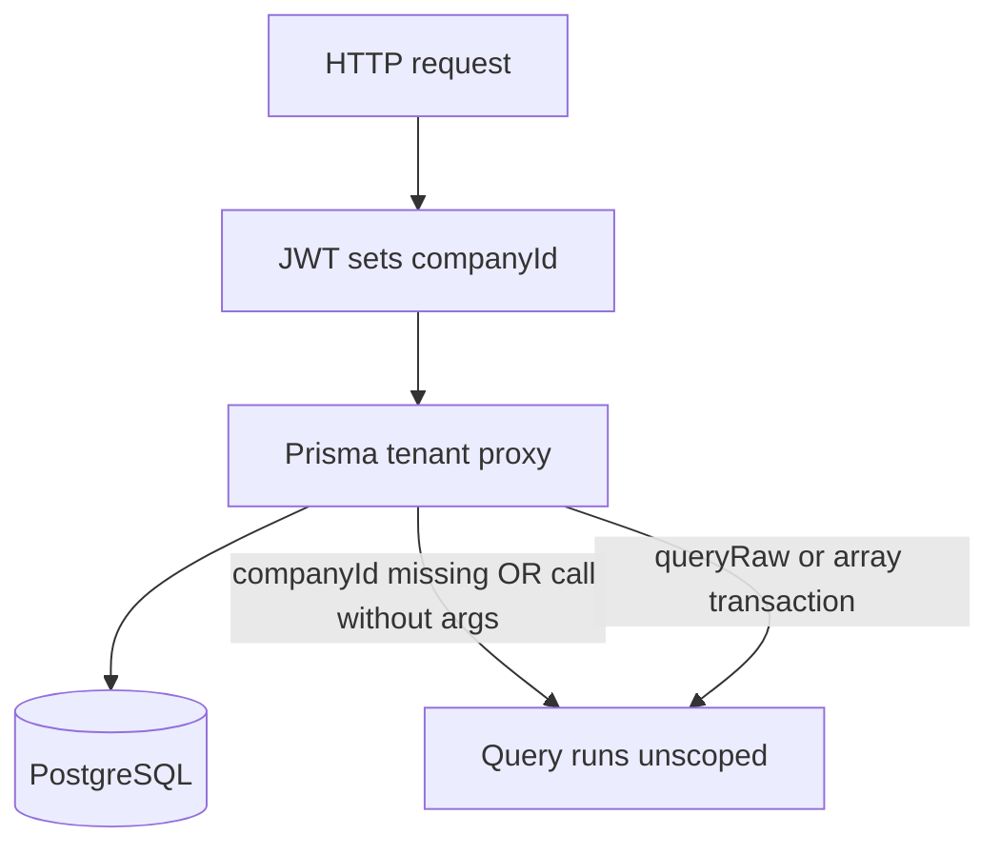

# NextOps

NextOps is a monorepo for a shared business-operations platform: each organization gets a workspace for its users, projects, products, orders, budgets, and integrations. The goal is to provide a reusable SaaS foundation so teams can focus on their own workflows instead of rebuilding basic application, data, and operations infrastructure.

> **Important:** This repository is a development foundation, not a fully production-ready SaaS product. Read [Implemented features and limitations](#implemented-features-and-limitations) before deploying or processing real customer data or payments.

## What the platform includes

- **Workspace-oriented data model:** PostgreSQL and Prisma models for companies, users, projects, products, orders, API history, budgets, and related resources.
- **Tenant-aware access:** authenticated requests derive the company from the signed-in user; Prisma query scoping and composite same-company foreign keys provide application/database safeguards.
- **Authentication:** registration, login, current-user lookup, logout, logout-all, password recovery, HttpOnly cookie sessions, CSRF token validation, revocable JWT sessions (Redis blacklist + session epochs), and server-to-server Bearer token support.
- **Team invitations:** OWNER/ADMIN invitation endpoint, expiring single-use invitation tokens, and an invitation acceptance page.
- **Role checks:** OWNER, ADMIN, MEMBER, and VIEWER. VIEWER is read-only for API methods protected by the global role guard; selected administrative endpoints require OWNER/ADMIN.
- **Operations UI:** responsive sidebar, module search, CRUD-oriented pages, API history pagination, a request console with DTO-aligned presets for authentication and backend resources, and a read-only database status console.
- **Order data safety:** product, order, and AI-budget money values use integer minor units in the database. Order creation snapshots active product prices on the server and calculates the total from product IDs and quantities.
- **Request idempotency:** mutating endpoints marked with `@Idempotent()` accept an `Idempotency-Key` header and are deduplicated by a Redis-backed interceptor; `POST /api/order` is covered.
- **Background email delivery:** BullMQ on Redis sends invitation email jobs with retry/backoff when Redis and SMTP are configured.
- **Operations and diagnostics:** structured Pino logging with redaction, API liveness/readiness endpoints, Prisma migrations, and PowerShell PostgreSQL backup/restore utilities.
- **Local stack:** Docker Compose can run PostgreSQL, Redis, a migration job, backend, frontend, and an optional daily backup worker.

## Repository layout

| Path | Purpose |
|---|---|
| `nextops-backend/` | NestJS API, Prisma schema and migrations, seed code, and database scripts |
| `nextops-frontend/` | Next.js App Router application, responsive UI, and API proxy |
| `docker-compose.yml` | Local PostgreSQL/Redis/API/frontend stack and optional backup profile |
| `.env.example` | Environment variable template for Docker Compose |
| `.github/workflows/ci.yml` | Dependency, Prisma, build, and TypeScript checks |

### Technology

- TypeScript, NestJS, Passport/JWT, Prisma, PostgreSQL
- Backend TypeScript runs with `strictNullChecks` and `strictBindCallApply`; the codebase contains no `any`
- The frontend API client auto-attaches an `Idempotency-Key` header to mutating requests, matching the backend interceptor
- Next.js App Router, React, Tailwind CSS, Lucide icons
- Redis and BullMQ for invitation and password-reset email jobs
- Pino-based structured logging
- Docker Compose for local services

## Frontend modules

The sidebar links to the following application routes. These pages are workspace data views/forms, not separate fully developed business products.

| Route | Purpose |
|---|---|
| `/` | Studio landing page and quick-start information |
| `/account` | External account/provider records |
| `/agentknowledgebase` | Project-linked agent knowledge records |
| `/apihistory` | API request history, creation form, and paginated browsing |
| `/category` | Product categories |
| `/order` | Create orders and review order records |
| `/payment` | Read-only view of payment fields on existing orders; does not charge cards |
| `/orderitem` | Order line-item records |
| `/product` | Product catalog and prices |
| `/project` | Workspace projects |
| `/review` | Product reviews |
| `/session` | Session records |
| `/user` | Workspace user records; administrative access is restricted |
| `/useraibudget` | AI usage budget records; administrative access is restricted |
| `/verificationtoken` | Verification token records |
| `/warehouse` | Product inventory/location records |
| `/webhookconfig` | Project webhook configuration; administrative access is restricted |
| `/invite?token=...` | Accept an emailed workspace invitation |
| `/forgot-password` | Request a password-reset email |
| `/reset-password?token=...` | Set a new password from the emailed reset link |

The sidebar is fixed on desktop and becomes a dismissible drawer below 1024px. Forms collapse into one column on small screens; wide data tables scroll within their own container. Sidebar links use Next.js client navigation and normal route prefetching. The two large utility consoles are loaded only when opened to avoid increasing the initial navigation bundle.

## Backend API

The NestJS API is mounted under `/api`. The frontend proxies `/api/*` and `/uploads/*` through Next.js to `BACKEND_URL`, so browser requests can stay same-origin.

### Authentication endpoints

| Method and route | Purpose |
|---|---|
| `POST /api/auth/register` | Create a company workspace and its first OWNER |
| `POST /api/auth/login` | Verify credentials and set the HttpOnly session cookie |
| `GET /api/auth/csrf` | Issue/read the CSRF token used for unsafe browser requests |
| `GET /api/auth/me` | Return the authenticated user and workspace identity |
| `POST /api/auth/logout` | Revoke the current session token (Redis blacklist) and clear the session cookie |
| `POST /api/auth/logout-all` | Sign out of every device: bumps the user's session epoch, invalidating all previously issued tokens |
| `POST /api/auth/forgot-password` | Request a password-reset link; responses are identical for existing and unknown accounts |
| `POST /api/auth/reset-password` | Consume a reset token, set the new password, and revoke all sessions |
| `POST /api/invitation` | Create an invitation (OWNER/ADMIN; ADMIN has role restrictions) |
| `POST /api/invitation/accept` | Accept an invitation using its token and set a password |

Standard resource routes generally support `GET /api/<resource>`, `GET /api/<resource>/:id`, `POST`, `PATCH /:id`, and `DELETE /:id`. The resources are `account`, `agentknowledgebase`, `apihistory`, `category`, `order`, `orderitem`, `product`, `project`, `review`, `session`, `user`, `useraibudget`, `verificationtoken`, `warehouse`, and `webhookconfig`. Individual controllers may have additional restrictions or resource-specific behavior.

Other useful endpoints:

- `GET /api/health/live` — process liveness.
- `GET /api/health/ready` — checks PostgreSQL connectivity.
- `PATCH /api/order/:id/pay` — deliberately returns `503 PAYMENT_PROVIDER_NOT_CONFIGURED`; it cannot confirm a payment.

`POST /api/order` (and any endpoint decorated with `@Idempotent()`) requires an `Idempotency-Key` header (8–200 chars, `A–Z a–z 0–9 . - _`). Replaying the same key with the same body returns the cached result instead of duplicating the write.

Collection responses are paginated:

```json
{
  "data": [],
  "meta": { "page": 1, "limit": 20, "total": 0, "totalPages": 0 }
}
```

Use `?page=2&limit=20` to request another page; the maximum page size is 100. API History has UI controls for page sizes 10 and 15. Most other module pages currently show only the first API page.

Request bodies and query DTOs are transformed and validated at the NestJS boundary. Unknown fields are rejected. API errors use a consistent JSON envelope; validation errors include field paths.

## Security and tenant boundaries

### Authentication and browser requests

- Browser login sets a seven-day HttpOnly JWT cookie; JavaScript cannot read the session cookie, and the token is not returned in the login JSON.
- JWTs are revocable: every token carries a session epoch, and every logout records a SHA-256 token fingerprint in a Redis blacklist. `logout-all` bumps the epoch, instantly invalidating every token ever issued for that user. Revocation checks fail closed (deny) when Redis is unreachable for a logged-out token lookup.
- `POST /api/auth/forgot-password` emails a single-use reset link (SHA-256-hashed token, 30-minute TTL). Resetting a password revokes all sessions.
- Unsafe browser methods require the CSRF cookie value in `X-CSRF-Token` and a trusted `Origin`.
- Bearer authentication remains available for server-to-server callers.
- Production requires a stable `JWT_SECRET` of at least 32 characters. Rotate and protect it as a credential.
- Prefer the same-origin frontend proxy. Cross-site deployments need HTTPS, `AUTH_COOKIE_SAME_SITE=none`, `AUTH_COOKIE_SECURE=true`, and exact trusted origins.

### Roles

- `OWNER`: workspace creator and administrator.
- `ADMIN`: administrative actions supported by the relevant controller.
- `MEMBER`: normal authenticated workspace access and permitted write operations.
- `VIEWER`: read-only for requests covered by the global role guard.

OWNER/ADMIN-only checks are applied to user, AI budget, webhook configuration, and invitation management endpoints. This is a fixed baseline role model, not a configurable permission matrix. Review each controller before assuming a business-specific authorization policy.

### Tenant isolation

The authenticated user's workspace is looked up by the backend; a request's `companyId` is not accepted as the authorization source. Prisma tenant scoping adds workspace context to tenant-owned reads and writes. Composite foreign keys in PostgreSQL prevent many cross-company relationships, and tenant-scoped unique constraints allow the same product/category slug in different companies.

**PostgreSQL Row-Level Security (RLS) is not enabled.** Composite foreign keys do not replace RLS policies or tests for every access path. Run cross-tenant integration tests and add RLS with a carefully verified connection/transaction context before claiming database-enforced row filtering.

The tenant migration intentionally stops if legacy rows have no verified `companyId`. Backfill ownership from trusted records before applying migrations; it does not assign old data to a shared default workspace.

## Using the application

1. Start the stack using Docker Compose or the local development commands below.
2. Open `http://localhost:3000`.
3. Open `/login`, choose **Create workspace**, and provide a unique email and a password of at least 12 characters. Registration creates the workspace and OWNER account, then signs you in.
4. To return to an existing workspace, open `/login` and sign in. The browser keeps the session in an HttpOnly cookie; expired sessions show a sign-in prompt. Forgot the password? Use **Forgot password?** on `/login` (or open `/forgot-password` directly) to receive a reset link; the emailed link opens `/reset-password?token=...` where a new password is set and every existing session is revoked.
5. Open a sidebar module to browse or manage records. Browser API calls use the same-origin `/api` proxy, and protected requests are scoped to the signed-in workspace.
6. To invite a teammate, send an authenticated `POST /api/invitation` request with an email and permitted role. Once Redis and SMTP are configured, the invitation link is emailed. The recipient opens `/invite?token=...`, chooses a password, then signs in at `/login`.
7. In **ApiHistory**, create and browse API-history records. Use the page controls below the table to change page size or select a page.
8. Use **POSTGRESQL_CONSOLE** for its supported read-only database/status commands. It is not a general-purpose SQL editor. **WEBHOOK ORCHESTRATOR** includes request examples for auth and backend DTOs; replace demonstration IDs with existing workspace record IDs. It only sends same-origin `/api/` requests.
9. **Payments** is informational only. Do not treat an order status or browser input as proof of payment.

For order creation, submit one or more product IDs and positive integer quantities. The backend verifies that products are active in the current workspace, snapshots their current `priceMinor`, and calculates `totalAmountMinor`. The client cannot set the total or unit prices. Product write forms accept ordinary decimal prices (for example `10.50`); product/order API responses expose minor-unit integer fields (for example `1050`).

## Run locally with Docker Compose

### Requirements

- Docker Desktop with Docker Compose
- Node.js 22 and Yarn 4 are needed for running checks and workspace commands outside the containers

### Start

1. Copy `.env.example` to `.env`.
2. Replace the sample PostgreSQL/Redis passwords and `JWT_SECRET` with unique strong values. Do not commit `.env`.
3. Start Docker Desktop and run from the repository root:

   ```powershell
   docker compose up --build
   ```

4. Open `http://localhost:3000`.

The API is available at `http://localhost:3001/api`. Verify:

- `http://localhost:3001/api/health/live`
- `http://localhost:3001/api/health/ready`

Compose starts PostgreSQL 17, Redis 7, a one-shot Prisma migration job, NestJS, and Next.js. The published service ports bind to localhost. This setup is for local development and is not a production TLS/reverse-proxy deployment.

### Invitation email and optional daily backups

Set `SMTP_URL`, `EMAIL_FROM`, and `FRONTEND_URL` in `.env` to deliver invitations. Redis is started by Compose. Email jobs use retries with exponential backoff; without a valid SMTP configuration invitation delivery is unavailable.

To start the optional daily local backup worker:

```powershell
docker compose --profile backups up -d backup
```

It keeps custom-format dumps in the `postgres-backups` volume for seven days. The volume is on the same host and is not an off-site disaster-recovery strategy.

## Run without Docker

1. Install dependencies from the repository root:

   ```powershell
   corepack enable
   yarn install --immutable
   ```

2. Start PostgreSQL and Redis. Configure `nextops-backend/.env` with a reachable `DATABASE_URL`, stable `JWT_SECRET`, `REDIS_URL`, and appropriate CORS/cookie settings. For local SMTP-less development, invitation email will not be available.
3. Validate the schema, generate Prisma Client, and apply committed migrations:

   ```powershell
   yarn db:validate
   yarn db:generate
   yarn db:migrate
   ```

4. Start both applications:

   ```powershell
   yarn start:dev
   ```

   Or use separate terminals:

   ```powershell
   yarn backend
   yarn frontend
   ```

The frontend defaults to the same-origin `/api` proxy to `http://localhost:3001`. In non-production mode, the API permits local HTTP origins on localhost/127.0.0.1. In production, configure exact CORS origins.

The backend loads `nextops-backend/.env` when started from its workspace directory. The frontend development server writes to `nextops-frontend/.next-dev/`, while production builds use `.next/`; do not delete or modify either directory while its corresponding process is running.

## Environment variables

| Variable | Used by | Description |
|---|---|---|
| `POSTGRES_USER`, `POSTGRES_PASSWORD`, `POSTGRES_DB` | Compose | PostgreSQL container credentials/database |
| `DATABASE_URL` | Backend/Prisma | PostgreSQL connection string |
| `JWT_SECRET` | Backend | Stable signing key; at least 32 characters in production |
| `REDIS_PASSWORD`, `REDIS_URL` | Compose/backend | Redis authentication and connection |
| `FRONTEND_PORT`, `BACKEND_PORT` | Compose | Local published ports (defaults 3000/3001) |
| `CORS_ORIGINS` | Backend | Comma-separated trusted browser origins |
| `AUTH_COOKIE_SAME_SITE` | Backend | Cookie SameSite policy; typically `lax` for same-site |
| `AUTH_COOKIE_SECURE` | Backend | Set `true` behind HTTPS in production |
| `AUTH_COOKIE_DOMAIN` | Backend | Optional cookie domain; normally leave empty for host-only |
| `FRONTEND_URL` | Backend | Base URL used to construct invitation links |
| `SMTP_URL`, `EMAIL_FROM` | Backend | SMTP connection and sender used by email worker |
| `LOG_LEVEL` | Backend | Pino log level |
| `BACKEND_URL` | Frontend build | Backend target used by Next.js API/upload rewrites |

Keep actual secrets out of source control, logs, screenshots, and support tickets. `.env.example` contains placeholders, not deployable credentials.

## Prisma schema and database migrations

- Schema: `nextops-backend/src/prisma/schema.prisma`
- SQL migration history: `nextops-backend/src/prisma/migrations/`
- Validate: `yarn db:validate`
- Generate client: `yarn db:generate`
- Deploy committed migrations: `yarn db:migrate`
- Seed (requires a configured database): `yarn workspace nextops-backend seed`

Before upgrading an existing database:

1. Take a verified backup.
2. Inspect legacy rows and establish company ownership from trusted data.
3. Backfill missing `companyId` values.
4. Test the migrations on an isolated restored copy.
5. Only then apply `yarn db:migrate`.

Tenant constraints fail closed if unassigned tenant data remains. The money migration converts the legacy floating-point order/product columns to integer minor units by rounding to two decimal places. It stops for negative values or values outside PostgreSQL `INTEGER` range. Review the conversion against a backup before applying it to financial data.

The AI-budget migration (`20261102090000_useraibudget_minor_units`) converts `monthlyLimit`/`currentUsage` floats to `monthlyLimitMinor`/`currentUsageMinor` integers. It fails closed on any value that is not exact whole cents or is out of `INTEGER` range — correct legacy rows before migrating.

## Backups and restore

With the Compose stack running, create a local custom-format backup:

```powershell
.\nextops-backend\scripts\database-backup.ps1 -Action backup
```

Restore replaces database contents and is destructive. Confirm the selected backup and target first:

```powershell
.\nextops-backend\scripts\database-backup.ps1 -Action restore -BackupFile .\backups\nextops-YYYYMMDD-HHMMSS.dump -Confirm
```

Run restore drills on an isolated environment. Production deployments need encrypted off-site copies, retention, access controls, and restore monitoring.

## Development and CI checks

Available root commands:

```powershell
yarn db:validate
yarn db:generate
yarn typecheck
yarn build:backend
yarn build:frontend
yarn build
yarn lint:frontend
```

GitHub Actions runs immutable dependency installation, Prisma validation/client generation, builds, and TypeScript checks on pushes and pull requests. These checks do not replace integration, security, database migration, or browser tests.

## Implemented features and limitations

Implemented safeguards and infrastructure are useful starting points, but the following important items are **not implemented or not complete**:

- Authentication uses a signed JWT in an HttpOnly cookie with Redis-backed revocation (token blacklist and session epochs) and password recovery. It is not yet a Redis-backed stateful session or a full Next.js BFF. CSRF validation is still required for cookie-authenticated unsafe methods.
- PostgreSQL RLS policies are not enabled. Tenant isolation relies on application scoping and database constraints; independently test all tenant access paths.
- Role checks are a fixed baseline and not a complete customizable RBAC/permissions system.
- No payment provider, checkout, signed payment webhook, processed-event register, financial ledger, subscription billing, or plan enforcement is configured. The payment confirmation API deliberately returns 503.
- A Redis idempotency interceptor is wired into `POST /api/order` via the `@Idempotent()` decorator; other mutating routes and future payment/webhook endpoints still need to be marked. Do not infer payment-event idempotency from its presence.
- BullMQ handles invitation and password-reset email jobs only. It is not a general-purpose reporting/payment processing pipeline.
- Daily backups are optional and local to the same Docker host; off-site backup replication and restore alerting are not included.
- Production observability, distributed rate limiting, comprehensive integration/security tests, and generated OpenAPI/client contracts remain to be completed.
- AI budget limits are stored as integer minor units (`monthlyLimitMinor`/`currentUsageMinor`); per-token micro-billing would still need an explicit business-unit/rounding policy.

Do not advertise the current checkout as a fully audited or production-ready multi-tenant SaaS service until these gaps are addressed and verified in the target deployment.

## Troubleshooting

- **Sidebar links feel slow in development:** Next.js development mode compiles route bundles on demand and is slower than a production build. Sidebar route prefetching is enabled by default for production; the previous explicit `prefetch={false}` disabled it. For realistic navigation checks, build and run the production frontend.
- **A page opens but has no records or shows 401/403:** sign in using **WEBHOOK ORCHESTRATOR**. Protected APIs require a valid session, and VIEWER or non-administrative roles cannot perform restricted writes.
- **Unsafe requests return `CSRF_VALIDATION_FAILED`:** refresh the session/CSRF token and use the same-origin `/api` proxy. Verify the browser Origin and `CORS_ORIGINS`; cross-site cookies require HTTPS and `SameSite=None; Secure`.
- **API reports Prisma `P1001`:** start PostgreSQL and check `DATABASE_URL`, or use Docker Compose. A running web process does not prove that the database is reachable.
- **Prisma reports `P2002`/`P2003`:** check uniqueness and ensure referenced records belong to the same workspace.
- **Tenant migration refuses to continue:** inspect and backfill legacy ownership; do not assign unknown data to an arbitrary company.
- **Prisma client generation fails on Windows with `EPERM` replacing a query-engine DLL:** close processes that are using the backend Prisma client, then retry `yarn db:generate`. Do not delete dependencies while the application is running.
- **Next.js manifests or chunks are missing:** stop conflicting Next.js processes and run `yarn build:frontend` again. Development and production use separate output directories.
# nextops_postgrsql


# Recommendations for making changes to the project
---
name: NextOps SaaS analysis
overview: "Розбір реального коду NextOps у Documents/nextops_postgrsql: що вже тримає мультитенантний фундамент, де захист зараз пропускає запит, і в якому порядку закривати дірки до продажу підписки."
todos:
  - id: phase-1-tenant-fail-closed
    content: Fail-closed tenant proxy, lock secret CRUD, required companyId, auth rate limits, cross-tenant tests in CI
    status: pending
  - id: phase-2-pagination
    content: Shared pagination and visible API errors on workspace list pages
    status: pending
  - id: phase-3-rls
    content: Postgres RLS with non-owner app role, transaction-scoped company id, retest isolation
    status: pending
  - id: phase-4-billing
    content: Platform subscription plans separate from order acquiring and signed webhooks
    status: pending
  - id: phase-5-ops
    content: Encrypted off-site backups, CI test job, audit of privileged writes
    status: pending
isProject: false
---

# Аналіз NextOps і порядок доробок


## Що вже зроблено сильніше, ніж у зібраних нотатках

Ізоляція тенанта не зводиться до ручного `where: { companyId }` у кожному сервісі. [prisma.service.ts](C:\Users\Admin\Documents\nextops_postgrsql\nextops-backend\src\prisma\prisma.service.ts) обгортає клієнт Prisma і для моделей зі списку `TENANT_MODELS` дописує `companyId` у `where` / `data`, якщо контекст уже встановлений. Контекст живе в `AsyncLocalStorage` ([tenant-context.ts](C:\Users\Admin\Documents\nextops_postgrsql\nextops-backend\src\prisma\tenant-context.ts)) і виставляється після JWT у [jwt.strategy.ts](C:\Users\Admin\Documents\nextops_postgrsql\nextops-backend\src\auth\strategies\jwt.strategy.ts). У схемі є складені зовнішні ключі `(id, companyId)`, тож чужий `productId` з іншої компанії база відхиляє.

Окремо вже є: Argon2id, HttpOnly JWT на 7 днів, CSRF (`Origin` + `X-CSRF-Token`), Redis blacklist і session epoch, інвайти та скидання пароля через BullMQ, ціни замовлення в minor units зі серверним snapshot у [order.service.ts](C:\Users\Admin\Documents\nextops_postgrsql\nextops-backend\src\order\order.service.ts), `@Idempotent()` лише на `POST /api/order`, пагінація API (`page` / `limit` / `meta`), Pino, health live/ready, Compose з Postgres 17 і Redis 7. `PATCH /api/order/:id/pay` свідомо віддає 503. `paymentStatus` клієнт через `UpdateOrderDto` не змінює.

Ролі — фіксований набір. `VIEWER` не пише. `OWNER`/`ADMIN` потрібні для user, AI budget, webhook config і запрошень. Решта мутацій відкрита й для `MEMBER`.

## Діри, які нотатки описують неточно



**Проксі тенанта зараз fail-open.** У `wrapTenantClient` якщо `companyId` порожній або метод викликано без об’єкта аргументів, запит іде в базу як є. Фонова задача, публічний шлях або новий `findMany()` без аргументів прочитає всі компанії. RLS це закриє лише після окремої ролі БД; до того проксі має кидати помилку, а не пропускати.

**RLS не вмикається одним `ALTER TABLE ... ENABLE ROW LEVEL SECURITY`.** Prisma тримає пул з’єднань. `SET LOCAL app.current_company_id` живе лише всередині транзакції. Власник таблиці і роль із `BYPASSRLS` політики не бачать. Міграції мають іти окремою роллю, застосунок — обмеженою, з `FORCE ROW LEVEL SECURITY`. Публічні шляхи (реєстрація, accept invite, reset password) мають власні політики, інакше реєстрація зламається. Це робота після тестів, не перший патч.

**Чутливі ресурси віддані як звичайний CRUD.** `Session`, `VerificationToken` і `Account` (з `access_token`, `refresh_token`, `id_token`) доступні автентифікованому `MEMBER` на читання і запис. Це ближче до витоку секретів, ніж відсутність другої сторінки товарів.

`**ApiHistory.companyId` nullable.** Рядок без компанії випадає з інваріанта тенанта. Унікальність `Account` на `(provider, providerAccountId)` глобальна, не в межах компанії.

**Статус замовлення обходиться без оплати.** `MEMBER` може `PATCH` статусу в `PROCESSING` або `SHIPPED`. Грошей це не списує, але операційний стан уже можна підробити з UI.

**AI-бюджет — запис у таблиці.** [useraibudget.service.ts](C:\Users\Admin\Documents\nextops_postgrsql\nextops-backend\src\useraibudget\useraibudget.service.ts) зберігає `monthlyLimitMinor` / `currentUsageMinor` і віддає їх у UI. Немає списання за виклик моделі, блокування при перевищенні і політики округлення. Вхід API ще приходить десятковим числом і округлюється через `Math.round`.

**Фронтенд читає лише першу сторінку, крім ApiHistory.** Хуки на кшталт [useProduct.ts](C:\Users\Admin\Documents\nextops_postgrsql\nextops-frontend\src\hooks\useProduct.ts) викликають `GET` без `page`, забирають `data` і гублять `meta`. Помилки 401/403 йдуть у `console.error`. Пошук у сайдбарі фільтрує назви модулів, не записи.

**Тестів немає.** У репозиторії нуль `*.spec.ts` / e2e. [ci.yml](C:\Users\Admin\Documents\nextops_postgrsql.github\workflows\ci.yml) робить install, Prisma validate/generate, build і typecheck. Немає Postgres service, Jest, ESLint у job і ліміту часу. `DATABASE_URL` у CI вказує на localhost, але база для перевірок не піднімається, бо міграції в CI не застосовуються.

**Білінг підписки і еквайринг замовлень — різні продукти.** `Company` має лише `id`, `name`, `createdAt`. Немає плану, статусу підписки, місць, `stripeCustomerId`. Оплата замовлення клієнта компанії і оплата доступу до самої платформи не замінюють одна одну. Віджет картки на `/payment` не робить платформу продаваною.

**Бекапи лишаються на тому самому хості.** Скрипт і профіль `backups` пишуть custom dump у локальний volume на 7 днів. Шифрування і зовнішня копія відсутні. Rate limit на login/register/forgot-password відсутній. OpenAPI, audit log, distributed tracing і деплой з main теж відсутні.

## Порядок, у якому це варто робити

Продаж підписки до фаз 1–3 збільшує ризик витоку між клієнтами і не дає чим обмежувати тариф.

### Фаза 1. Закрити доступ, поки даних ще мало

- У проксі тенанта: для моделі з `TENANT_MODELS` без `companyId` кидати `ForbiddenException`, не виконувати запит. Те саме для виклику без аргументів.
- Прибрати з публічного CRUD секрети: `Session`, `VerificationToken`, поля токенів у `Account`. Лишити адмінські read-only подання без секретів або закрити маршрути.
- `ApiHistory.companyId` зробити обов’язковим. Унікальність акаунта провайдера звузити до компанії.
- `PATCH /order/:id` для статусів відвантаження дозволити лише `OWNER`/`ADMIN`, окремо від `paymentStatus`.
- Redis rate limit на `register`, `login`, `forgot-password`, `reset-password`, `invitation/accept`.
- Інтеграційні тести на реальному Postgres у CI: компанія A читає і пише id компанії B для order, product, user, webhook; очікування 404/403 і порожній список. Сюди ж тест, що запит без контексту не повертає рядки.

### Фаза 2. Кабінет, яким можна користуватися після 20 записів

- Спільний хук пагінації за зразком [useApihistory.ts](C:\Users\Admin\Documents\nextops_postgrsql\nextops-frontend\src\hooks\useApihistory.ts) для product, order, project, user, category та решти модулів.
- Показ помилки API на сторінці, а не лише в консолі.
- Серверні `search` / фільтр статусу там, де список операційний (замовлення, товари, користувачі).

### Фаза 3. RLS як другий контур, не заміна тестів

- Окрема роль `nextops_app` без володіння таблицями, `FORCE ROW LEVEL SECURITY`.
- Кожен запит застосунку в транзакції з `set_config('app.current_company_id', ..., true)`.
- Політики на всі тенант-таблиці; винятки лише для реєстрації, інвайта і скидання пароля, з вузькими функціями.
- Ті самі тести фази 1 прогнати повторно вже проти RLS, включно з прямим SQL під роллю застосунку.

### Фаза 4. Гроші: спочатку підписка платформи

- Модель `Plan` + поля компанії: план, статус (`trialing` / `active` / `past_due` / `canceled`), період, зовнішній customer id.
- Обмеження місць і модулів у guard до запису (наприклад, ліміт користувачів).
- Stripe або Paddle для підписки платформи: Checkout + webhook із перевіркою підпису, ідемпотентний журнал подій, оновлення статусу компанії. Блокування кабінету при `past_due` після пільгового вікна.
- Еквайринг замовлень (Stripe / LiqPay) окремим контуром: сума лише з `totalAmountMinor`, підпис webhook, заборона виставляти `paymentStatus` з браузера. `/payment` лишається read-only, доки цей контур не пройде тести підпису.

### Фаза 5. Експлуатація

- Шифрований dump у R2 або B2, окремий бакет, перевірка відновлення на чистій базі за розкладом.
- CI: Postgres service, Jest, ESLint, кеш Yarn; образи збирати після зеленого main, не на кожен push чернетки.
- Мінімальний audit: хто змінив ціну, статус замовлення, роль користувача.

AI-бюджет як списання токенів має сенс лише після фази 1 і явної одиниці обліку (цент за запит чи мікро-одиниці за токен). До цього сторінка бюджету лишається довідником ліміту, не білінгом.

## Що не варто робити першим

Віджет введення картки, безкінечний скрол і «тариф Basic за $19» не компенсують fail-open проксі, CRUD секретів і відсутність тестів ізоляції. Хмарний бекап потрібен до перших чужих даних, але він не замінює виправлення доступу.
Чого не вистачає до «Повноцінного SaaS» 

- Щоб почати продавати доступ до цієї платформи іншим компаніям підписку, вам потрібно реалізувати наступні модулі:
- Біллінг та Тарифи (Stripe/Paddle): Зараз у вас немає прив'язки компанії до тарифного плану (наприклад, Basic, Pro, -  - Enterprise). Потрібно додати логіку: «Якщо компанія не оплатила підписку — блокувати доступ до кабінету» або «Тариф  -  Basic дозволяє мати лише 3 користувачів».
- Платіжний шлюз: Як вказано в логах, метод /pay повертає 503 . Потрібно підключити реальний еквайринг і обробку вебхуків від платіжки (з валідацією підписів).
- База даних (Row-Level Security): Зараз ви фільтруєте дані кодом через Prisma (App Scoping) . Це працює, але якщо розробник десь забуде дописати .findMany({ where: { companyId } }), одна компанія побачить дані іншої. Увімкнення - - - - PostgreSQL RLS (Row-Level Security) на рівні самої бази застрахує вас від людської помилки .

. Що ви упустили (Найкритичніші дірки)

• Платіжний шлюз повністю відсутній. Ендпоінт PATCH /api/order/:id/pay просто повертає помилку 503. Без підключення Stripe, LiqPay або іншого еквайрингу цей SaaS не може приймати гроші. Немає обробки вебхуків від платіжних систем, перевірки їхніх підписів та логіки підписок (SaaS-тарифів).
• Слабкий захист між клієнтами (Tenant Isolation). Ви поклалися виключно на Prisma (код застосунку). Якщо новий програміст у вашій команді забуде написати .findMany({ where: { companyId } }) у новому контролері — один клієнт побачить дані іншого. PostgreSQL Row-Level Security (RLS) не увімкнено.
• Фронтенд «недопилений». Пагінація є в БD, але на фронтенді більшість сторінок показують лише першу сторінку даних. Клієнт, у якого буде понад 20 товарів чи користувачів, просто не зможе їх погортати.
• AI-бюджети — лише цифри в БD. Поля monthlyLimitMinor ви створили, але самої логіки підрахунку токенів (скільки зняти за один запит до ChatGPT/Claude) і блокування користувача, якщо ліміт вичерпано, в коді немає.
• Локальні бекапи — це ризик. Скрипт зберігає дампи на тому самому Docker-хості. Якщо «помре» сервер, згорять і бекапи.

2. Що треба терміново дописати / доділати (Ваш чек-лист)


БЕЗПЕКА ТА БD:

1. Увімкнути Row-Level Security (RLS) у PostgreSQL. Налаштувати Prisma так, щоб при кожному запиті в базу передавався контекст companyId, і сама БD блокувала доступ до чужих рядків на рівні ядра.
2. Написати крос-тенантні тести. Автоматичні тести, які імітують хакерський запит від Компанії А з метою прочитати замовлення Компанії Б (перевірка на уразливість BOLA/IDOR).

ФІНАНСИ ТА БІЛІНГ:

3. Інтегрувати платіжний шлюз. Написати логіку створення інвойсів, підключити фронтенд-віджети для введення карток.
4. Створити обробник вебхуків (Webhook Endpoint). Він має приймати повідомлення від платіжки (наприклад, «платіж успішний»), обов'язково валідувати криптографічний підпис шлюзу та оновлювати статус замовлення.
5. Додати білінг підписок. Логіку тарифних планів (наприклад: Базовий — $19/міс, Про — $49/міс) та обмеження функціоналу залежно від тарифу (Plan Enforcement).

ІНФРАСТРУКТУРА (DEVOPS):

6. Винести бекапи в хмару. Переписати PowerShell/Bash скрипти, щоб вони шифрували дамп бази і заливали його на AWS S3, Cloudflare R2 або Backblaze B2.
7. Rate Limiting (Захист від спаму). Обмежити кількість запитів (особливо на логін, реєстрацію та відновлення пароля), щоб систему не завалили брутфорсом.

ФРОНТЕНД:

8. Додати компоненти пагінації. Дописати на всіх сторінках (товари, проекти, користувачі) кнопки «Вперед/Назад» або Infinite Scroll.
  Рекомендації щодо покращення та розробки SaaS-платформи
1. Безпека та Ізоляція даних (Multi-Tenancy)
PostgreSQL RLS (Row-Level Security): Увімкни захист на рівні таблиць БД (ALTER TABLE "Project" ENABLE ROW LEVEL SECURITY;), щоб база намертво блокувала доступ чужих компаній до даних.

Context Middleware: Налаштуй NestJS так, щоб він автоматично підставляв company_id поточного користувача в транзакцію бази даних (SET LOCAL app.current_company_id = '...'). Це захистить від хакерських атак типу BOLA/IDOR.

Тести на ізоляцію: Напиши E2E-тести, де компанія «А» намагається вкрасти дані компанії «Б».

2. Платежі та Білінг (Stripe)
Інтеграція Stripe: Замість заглушок підключи реальний Stripe Checkout для оплати та підписок.

Гроші в центах: Усі суми обов'язково зберігай цілими числами в дрібних одиницях (центах / minor units), щоб уникнути похибок округлення у плавучій точці (float).

Вебхуки зірки: Зроби захищений ендпоінт для подій від Stripe з обов'язковою перевіркою підпису (Stripe-Signature).

3. Масштабування та Надійність
Redis для лімітів (Rate Limiting): Перенеси захист від спаму і брутфорсу з пам'яті сервера у спільний Redis, щоб ліміти працювали навіть при запуску кількох інстансів програми.

Хмарні бекапи: Налаштуй автоматичне збереження зашифрованих дампів бази у зовнішнє сховище (AWS S3 / Cloudflare R2) з регулярними тестовими відновленнями.

4. Стандарти коду
Суворий TypeScript: Повна заборона типу any. Використовуй тільки строгі типи та strictNullChecks, щоб виловлювати баги ще під час компіляції.
. Швидка перевірка PR — > паралельно запуск ESLint, перевірки TypeScript та тестування Jest. Використовуйте легкий сервісний контейнер PostgreSQL для інтеграційних тестів, щоб Prisma працювала з реальною базою даних, а не з крихкими макетами. Тримайте весь цей забіг менше трьох хвилин.

2. Шарово-кешовані збірки образів -> Створюйте та запускайте свій Docker-контейнер лише після об'єднання з основним. Використовуйте GitHub Actions або кешування реєстру AWS, щоб залежності не перевстановлювалися при кожному запуску.

3. Пряме розгортання -> Запускати автоматичне розгортання безпосередньо з основного через вебхук або раннер, який отримує новий образ і перезапускає сервіс.

1. Завжди фіксуйте сирі запити під час розробки. Якщо кінцева точка запускає десятки SQL-операторів для одного запиту, її потрібно негайно переписувати. 

2. Відправте обчислення в PostgreSQL. Якщо потрібні підрахунки або суми, використовуйте Prisma groupBy, _count або закрийте до $queryRaw з належним JOIN замість обчислень у Node.js пам'яті. 

3. Будьте суворими у виборі. Перезавантаження реляційних моделей — найшвидший спосіб роздувати корисні навантаження та різко збільшити використання пам'яті. 


Загальна архітектура системи (System Architecture)
flowchart TB
    subgraph Client ["Клієнтський шар (Frontend)"]
        Browser["Next.js App Router (UI / Tailwind / Lucide)"]
    end

    subgraph Gateway ["Шлюз та безпека (API Proxy)"]
        NextProxy["Same-Origin Proxy (/api/*)"]
        CSRF["CSRF Token & HttpOnly Cookie Validation"]
        Idempotency["Redis Idempotency Interceptor (POST /api/order)"]
    end

    subgraph Backend ["Бекенд-шар (NestJS API)"]
        TenantGuard["Tenant Context & Role Guards (OWNER, ADMIN, MEMBER, VIEWER)"]
        PrismaProxy["Prisma ORM (AsyncLocalStorage Tenant Scoping)"]
        BullMQ["BullMQ Workers (Redis-backed Email Queue)"]
    end

    subgraph Database ["Сховище даних (Infrastructure)"]
        Postgres[(PostgreSQL 17\nComposite Foreign Keys)]
        Redis[(Redis 7\nBlacklist & Sessions)]
        SMTP["SMTP Mailer"]
    end

    Browser -->|HTTPS / WSS| NextProxy
    NextProxy --> CSRF
    CSRF --> Idempotency
    Idempotency --> TenantGuard
    TenantGuard --> PrismaProxy
    PrismaProxy --> Postgres
    TenantGuard --> Redis
    BullMQ --> SMTP
    